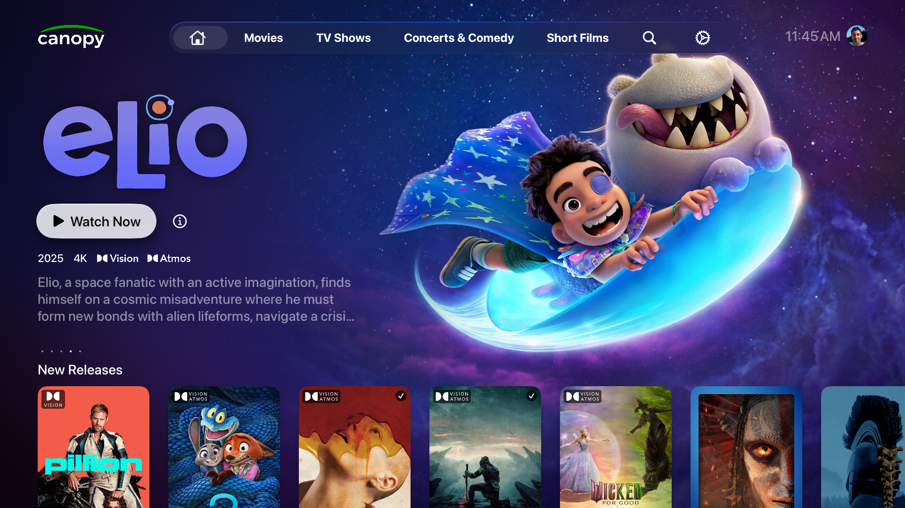
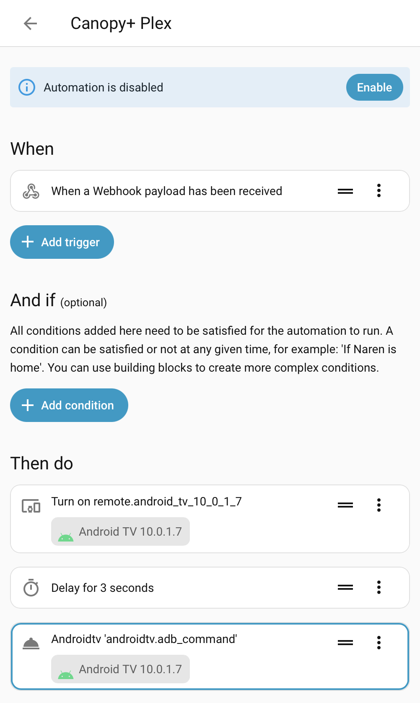
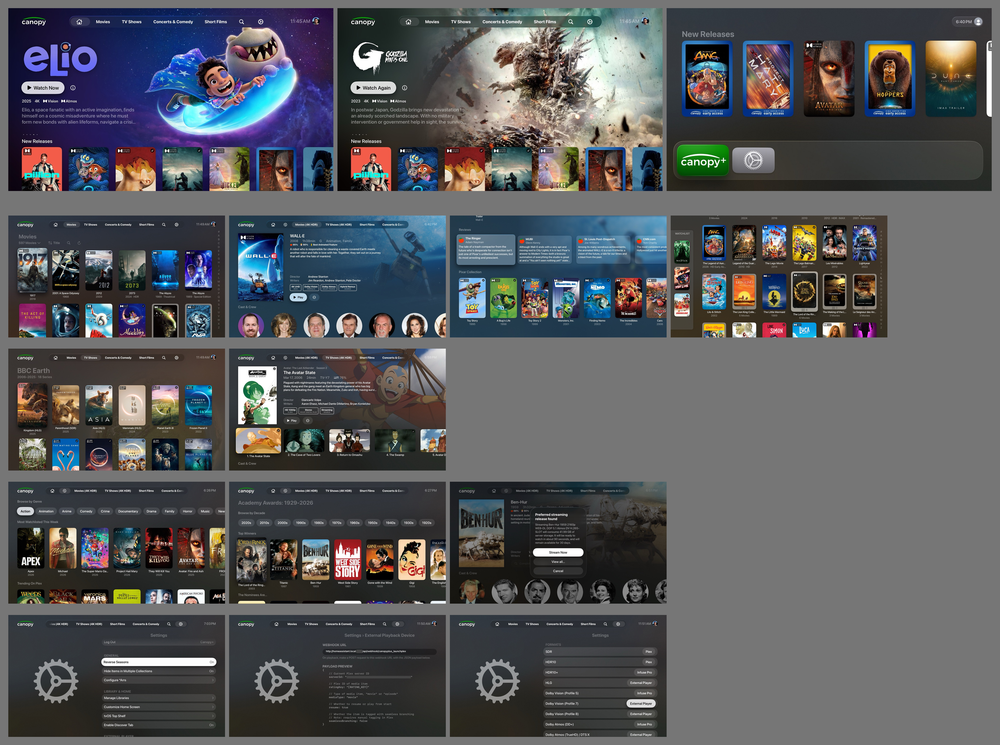

<h1>
  
  Canopy+
</h1>

A Plex frontend for tvOS, human-written* in SwiftUI. Meant for integrating with CoreELEC (Ugoos AM6B+) or Nvidia Shield.

<p align="center">
  
</p>

## Download
Canopy+ is available on the tvOS App Store. Voice search for "canopy plus"!

<a href='https://apps.apple.com/us/app/canopy/id6742864890'></a>

## Login
- Standard accounts and managed Home users are both supported, including PIN enforcement.

## Default Video Player
Canopy+ uses a custom playback UI on top of AetherEngine, allowing native support for Dolby Vision Profiles 5 and 8, with on-the-fly conversion of 7 to 8.1. DD+ (lossy) Atmos is also passed natively via Dolby MAT. HLG is converted to HDR10, and HDR10+ metadata is transmitted automatically on the 3rd and 4th gen.

## External Player
Canopy+ can hand playback off to another box, like CoreELEC or an Nvidia Shield, for the formats the Apple TV can't play properly. You browse on the Apple TV, and playback starts on the other device.

You can set this up with or without Home Assistant, although I personally think having HASS available makes everything work a little bit better.

### Without Home Assistant (PlexKodiConnect)
For Kodi with [PlexKodiConnect](https://github.com/croneter/PlexKodiConnect) (PKC). Nothing to install besides PKC itself.

- Make sure Plex Companion is enabled in PKC's settings (it's on by default).
- In Canopy+, open **Settings › External Player**, set **External Player** to **PlexKodiConnect**, and enter your Kodi box's IP and PKC's Companion port (default `3005`).
- In **Settings › Devices & Formats**, choose which formats should play on Kodi.

Canopy+ asks PKC to play the item over Plex Companion, so you get a normal Plex session and your watched status syncs.

Note: on some setups, playback started this way occasionally fails the HDMI handshake (picture never comes up after the TV/AVR switches inputs). If that happens to you, the Home Assistant setup below starts playback a different way and doesn't have the problem.

### With Home Assistant
Canopy+ sends a webhook to Home Assistant, and Home Assistant starts playback. This takes a few more minutes to set up, but it lets you do anything else you want at the same time: switch AVR inputs and sound modes, turn amps on or off, dim the lights, etc.

In Canopy+, open **Settings › External Player**, set **External Player** to **Webhook**, and enter your webhook URL. Then choose formats in **Settings › Devices & Formats**.

On every playback, Canopy+ POSTs this JSON to the webhook:

```json
{
  "serverId": "<your Plex server's machine identifier>",
  "ratingKey": "12345",
  "mediaType": "movie",
  "resume": true,
  "seamlessBranching": false,
  "startPlaying": true
}
```

`mediaType` is `movie` or `episode`.

> [!TIP]
> Use your Home Assistant's IP address in the webhook URL, not `homeassistant.local`. The Apple TV can usually resolve `.local` names, but plenty of other things (Docker containers, for one) can't, and an IP always works. Give Home Assistant a DHCP reservation so the IP doesn't change.

#### CoreELEC / Kodi
Requires PKC, using **add-on paths** (PKC's default). PKC names every library item it syncs `plugin://plugin.video.plexkodiconnect…?plex_id=<ratingKey>&…`, so Home Assistant can find the Kodi item for a Plex rating key by asking Kodi directly, then play it from Kodi's own library. Nothing runs on the Kodi box. This doesn't work with PKC's direct paths.

PKC quirk: any TV show set to "hide seasons" in Plex won't sync properly. Make sure all your shows show their seasons. This is a longtime Plex API issue that PKC hasn't been able to work around.

1. In Kodi, turn on **Settings › Services › Control › Allow remote control via HTTP**. Note the port (default `8080`), username (default `kodi`) and password.
2. Put the Kodi password in `secrets.yaml`, in the same folder as `configuration.yaml` (create the file if it doesn't exist):

   ```yaml
   kodi_password: your-kodi-password
   ```

3. Add these to `configuration.yaml`, replacing `KODI_IP`:

   ```yaml
   rest_command:
     kodi_lookup:
       url: "http://KODI_IP:8080/jsonrpc"
       method: POST
       username: kodi
       password: !secret kodi_password
       content_type: "application/json"
       payload: >-
         {"jsonrpc":"2.0","id":1,
          "method":"{{ 'VideoLibrary.GetMovies' if media_type == 'movie' else 'VideoLibrary.GetEpisodes' }}",
          "params":{"filter":{"field":"filename","operator":"contains","value":"plex_id={{ rating_key }}&"}}}
     kodi_play:
       url: "http://KODI_IP:8080/jsonrpc"
       method: POST
       username: kodi
       password: !secret kodi_password
       content_type: "application/json"
       payload: >-
         {"jsonrpc":"2.0","id":2,"method":"Player.Open",
          "params":{"item":{"{{ media_type }}id":{{ kodi_id }}},"options":{"resume":{{ resume | lower }}}}}
   ```

4. Restart Home Assistant.
5. Create an automation (**⋮ › Edit in YAML**) and paste:

   ```yaml
   alias: Canopy+ play on Kodi
   mode: single
   triggers:
     - trigger: webhook
       webhook_id: canopy-play
       allowed_methods: [POST]
       local_only: true
   actions:
     # Your own steps go here: wake the TV, switch the AVR input,
     # set a sound mode, run a script, adjust lights...
     - action: rest_command.kodi_lookup
       data:
         media_type: "{{ trigger.json.mediaType }}"
         rating_key: "{{ trigger.json.ratingKey }}"
       response_variable: lookup
     - variables:
         items: "{{ lookup.content.result[trigger.json.mediaType ~ 's'] | default([]) }}"
     - condition: "{{ items | count > 0 }}"
     - action: rest_command.kodi_play
       data:
         media_type: "{{ trigger.json.mediaType }}"
         kodi_id: "{{ items[0][trigger.json.mediaType ~ 'id'] }}"
         resume: "{{ trigger.json.resume }}"
   ```

6. Your webhook URL is `http://HOME_ASSISTANT_IP:8123/api/webhook/canopy-play`.

Calling a script with `action: script.your_script` waits for it to finish before moving on, so playback starts once your setup is done. That's usually what you want, so the AVR is already on the right input and sound mode when Kodi starts. Use `action: script.turn_on` instead if you'd rather playback start right away and the script run alongside it.

To test without the Apple TV, find a rating key (in Plex Web, **Get Info › View XML** on any movie, the number after `/library/metadata/` in the URL) and run:

```sh
curl -i -X POST http://HOME_ASSISTANT_IP:8123/api/webhook/canopy-play \
  -H 'Content-Type: application/json' \
  -d '{"ratingKey":"12345","mediaType":"movie","resume":true}'
```

Home Assistant answers `200` whether or not the automation worked, so check the automation's **Traces** to see what happened.

#### Nvidia Shield
1. In Home Assistant, set up the [Android Debug Bridge](https://www.home-assistant.io/integrations/androidtv/) integration for your Shield.
2. Create an automation with a **Webhook** trigger.
3. Under **Then do**, wake the Shield, delay for 3 seconds, then run this ADB command:

   ```
   am start -a android.intent.action.VIEW -p com.plexapp.android -d 'plex://watch/video?uri=server%3A%2F%2F{{ trigger.json.serverId }}%2Fcom.plexapp.plugins.library%2Flibrary%2Fmetadata%2F{{ trigger.json.ratingKey }}plex://libraries/{{ trigger.json.serverId }}/metadata/{{ trigger.json.ratingKey }}'
   ```

   This starts playback straight away, or opens the item's page in Plex when Canopy+ asks it only to open the item. Keep the single quotes around the link, so the shell passes it to Plex untouched.

4. Copy the webhook URL (`http://HOME_ASSISTANT_IP:8123/api/webhook/WEBHOOK_ID`) into Canopy+ as above.

The Shield's CEC works properly, so your TV/AVR/soundbar should switch inputs on its own.

> [!NOTE]
> Older guides use `plex://server://…` with an `android.intent.extra.START_PLAYBACK` extra. Current versions of Plex for Android TV ignore both, so use the links above.



## Seerr
- Canopy+ supports one-click Seerr authentication.
- Log in to Seerr with your Plex account at least once on another device first, otherwise Seerr will reject the request.
- Enter your Seerr host and click connect. Users can then request movies and TV seasons in Seerr.

## Prowlarr
- Canopy+ supports Prowlarr with an API key.
- You can set up multiple download clients in Prowlarr that download to different folders. For ephemeral streaming, configure one to delete downloads after a time interval or disk quota, and enter that download client's ID in the "Streaming" section of Prowlarr settings in Canopy+.
- You can also specify a permanent download client to enable "Add to Library".
- Both buttons work exactly the same way, so it's up to you which to configure and use.
- My personal setup:
    - My home: both "Streaming" and "Add to Library" configured. **This disables Seerr for movies** (it would be redundant).
    - Family home: "Streaming" enabled. Family members request in Seerr to save things permanently to my library.
    - Close friends: no Prowlarr access. They request everything.

## AI Disclosure
- Canopy+ is almost entirely human-coded, with one major exception: the schema, networking, and data models for Plex's Discover and Metadata endpoints.
- All UI and app logic is human-written.
- The integration docs in this repo were written with significant help from AI. I'm new to homelab stuff and am primarily an iOS engineer.

## More Screenshots
<p align="center">
  
</p>
